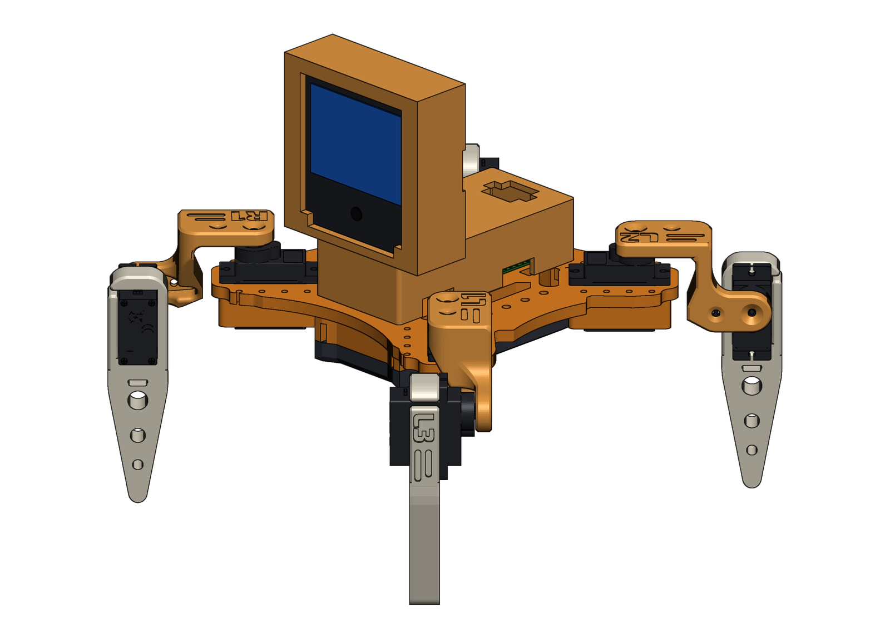
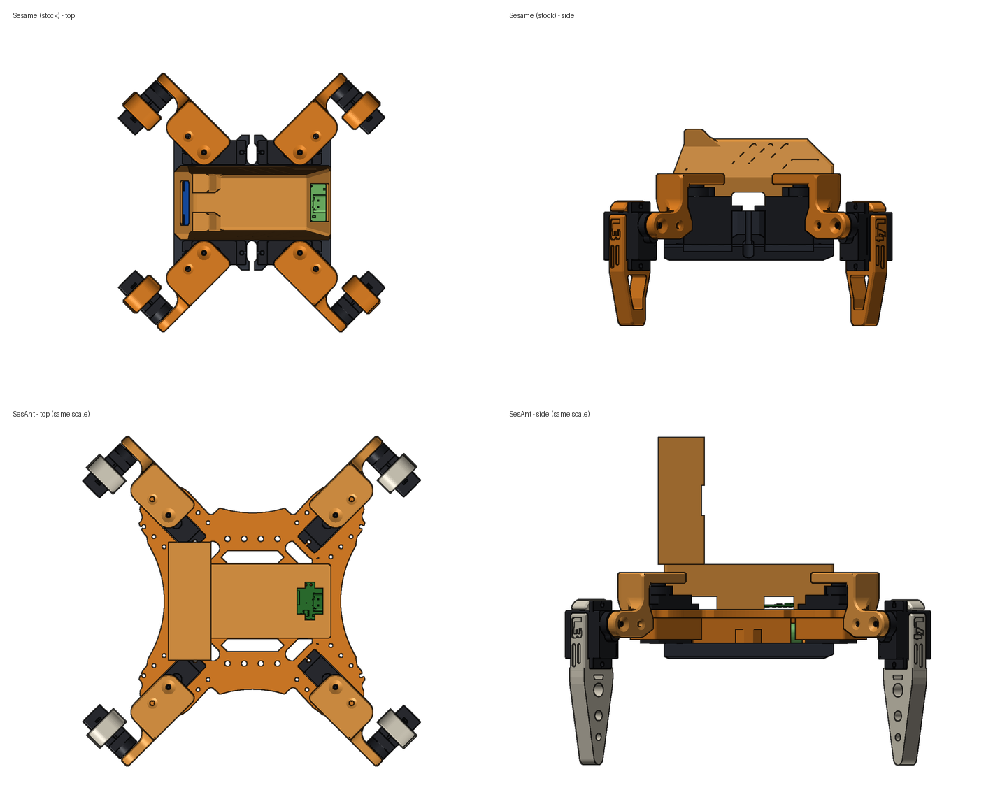
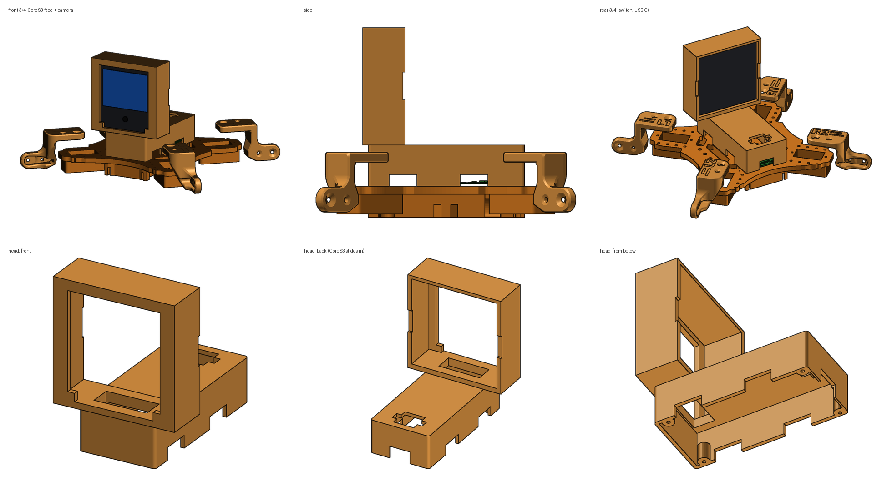
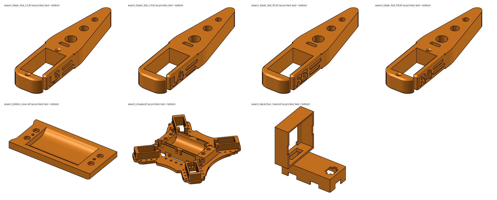
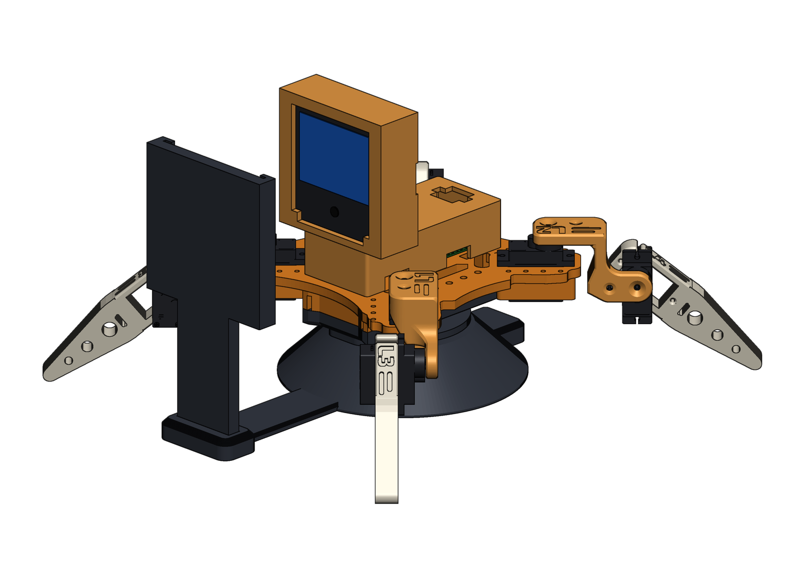
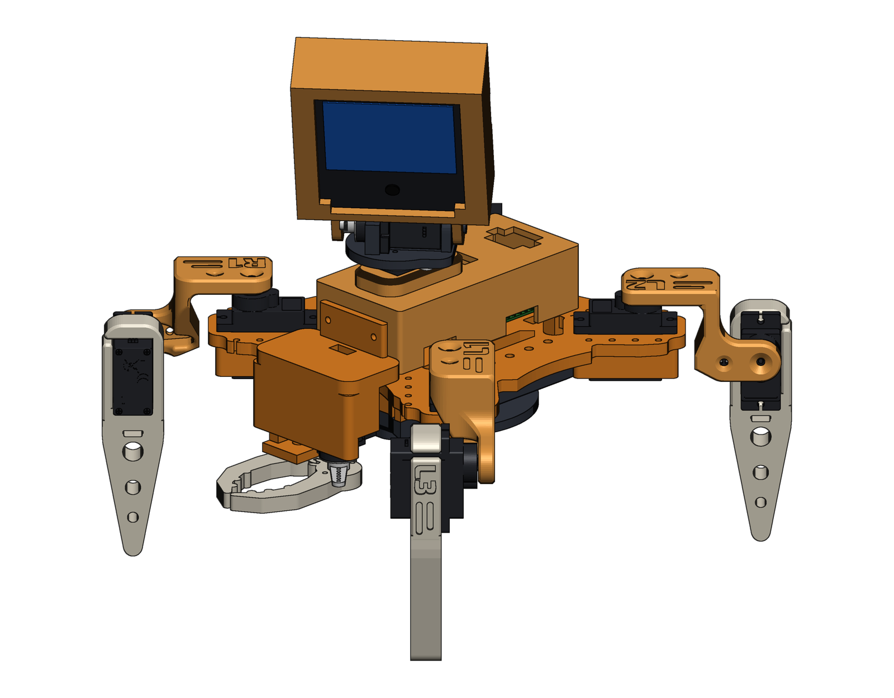
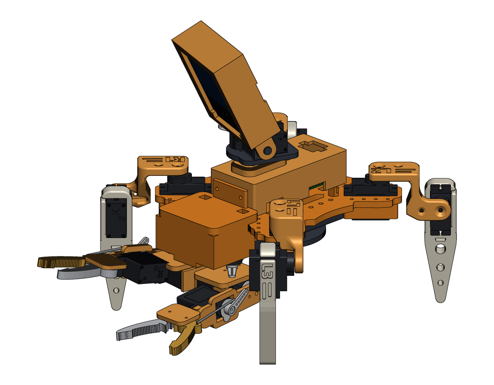
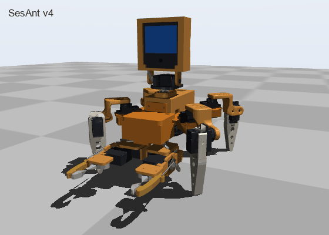

# SesAnt: RealAnt's body plan, Sesame's brain, StackChan's face



**SesAnt** is a remix of two open-source quadrupeds:

* **[RealAnt](https://github.com/semberecki/realant)** (Ote Robotics): an RL research quadruped with an X-shaped body plate, Dynamixel AX-12A servos and long tapered blade legs.
* **[Sesame](https://github.com/dorianborian/sesame-robot)** (Dorian Todd): a cheap, expressive ESP32 quadruped with 8× MG90S servos, an OLED face and magnetic hats.
* **[StackChan](https://github.com/m5stack/StackChan)** (M5Stack + community): an AI desktop robot whose head is an M5Stack CoreS3 (camera, 2" touch screen, mics, speaker, IMU).

SesAnt keeps Sesame's servo electronics, servos and femurs. It adds RealAnt's X-chassis, its blade shins and its serial protocol. Sesame's OLED top cover is replaced by a **StackChan head**: a printed body cover with an M5Stack CoreS3 built into its front, so the CoreS3 screen is the face and its camera looks forward. The result is a RealAnt-style RL robot for roughly $60 of Sesame-class parts plus a CoreS3 (about $60), instead of 8 Dynamixels.

The remix changes **how the robot works**, not just how it looks:

| | Sesame (stock) | **SesAnt** | How |
|---|---|---|---|
| Hip layout | compact box, hips on a ~49 × 51 mm rectangle | **radial X, hips 61 mm from centre on the diagonals** (RealAnt layout) | new chassis from RealAnt `body_v6` outline + radial servo pods |
| Hip servo orientation | along the body | **along each arm** (like RealAnt's AX-12A) | pods rotated 45° |
| Collision-free hip sweep | ±56° (front pair) / ±60° (side pair) | **±90°, the full servo range, no leg can touch another leg or the body** | verified by mesh collision sweep, see below |
| Shin | 58 mm truss foot, tip 47 mm below knee | **RealAnt tapered blade, tip 66 mm below knee (+40 %)** | Sesame foot clamp + RealAnt `leg_v8` profile |
| Ground clearance (standing) | ~31 mm | **~50 mm** | longer shins |
| Knee range (blade vs femur/body) | n/a | **−120° … +50° from vertical** | verified |
| Host interface | Sesame Web UI / JSON API | **RealAnt serial protocol** (`ant_server.py` → ZeroMQ → realant-rl) | `firmware/sesant_realant_bridge` |
| Face | 0.96" OLED | **StackChan head: CoreS3 2" screen as the face** | `sesant_stackchan_head` replaces Sesame's top cover |
| Vision / audio / IMU | none | **forward camera (GC0308), mics, speaker, 9-axis IMU** | CoreS3 built into the head |
| WiFi MCU for servos, battery | ✓ | ✓ unchanged | reused Sesame electronics |





---

## What's in this folder

```
seasant/
├── stl/                         print-ready, already oriented (bed = Z=0), all watertight
│   ├── sesant_chassis.stl            RealAnt X-plate + Sesame spine + 4 radial MG90S pods (1×)
│   ├── sesant_bottom_cover.stl       Sesame bottom cover trimmed to the spine (1×)
│   ├── sesant_blade_foot_L3/L4/R3/R4.stl   Sesame foot clamp + RealAnt blade (1× each)
│   └── sesant_stackchan_head.stl     body cover + integrated CoreS3 face/camera; replaces Sesame's top cover (1×)
├── firmware/sesant_realant_bridge/   ESP32-S2 sketch: RealAnt serial protocol on Sesame hardware
├── assembly/
│   ├── sesant_assembly.glb           full coloured assembly (servos, electronics, all parts)
│   ├── sesant_geometry.json          hip/knee axes, heights (for URDF/MJCF or kinematics)
│   └── verification_report.txt       collision + clearance checks (generated)
├── images/                      renders
├── ROADMAP.md                   v2 (home puck) and v3 (neck + mandibles): goals, design, what is verified, next steps
├── v2/                          v2: home puck - belly cone + charging funnel, any-heading contacts, firmware, bench tool
├── v3/                          v3: StackChan pan/tilt neck (SCS0009) + ant mandibles (MG90S + gear pair), firmware
├── v4/                          v4: Jumper remix - two front arms (yaw, pitch, two-jaw Jumper claw), MuJoCo model + sesant.flat task, firmware
└── cad/                         generator scripts (reproduce everything from the source repos)
```

Reused **unchanged** from Sesame (`sesame-robot/hardware/printing/stl/`):
`L1-v117`, `L2-v117`, `R1-v117`, `R2-v117` (femurs). Sesame's `Internal-Frame`, `Bottom-Cover`, top cover (with the OLED) and feet `L3/L4/R3/R4` are **replaced**.

## How the parts were made (remix provenance)

Everything is generated from the original files by `cad/scripts/build.py`. Nothing was re-modelled by hand:

1. **Chassis.** I sliced RealAnt's `body_v6.stl` at mid-thickness, then rotated it 45° and scaled it ×0.9 so the arms point to the leg corners. I kept its arc outline and hole rows. Sesame's `Internal-Frame-v121.stl` is cut to its central strip (|y| ≤ 19 mm). That strip keeps the battery channel, the S2 Mini/Distro board mounts, the cover screw counterbores and the bottom-cover screws, so Sesame's electronics drop in unchanged. Four servo pods sit at the arm tips. They reuse Sesame's exact servo seat height: the tabs rest at the same z as in Sesame and the M2 pilot holes are 27.8 mm apart. Each pod is rotated so the servo lies along the arm, like RealAnt's AX-12As. Each femur's real swept footprint over ±92° is subtracted from the plate, which is what makes the full hip range possible.
2. **Blade feet.** I transformed Sesame's foot (from the assembly STEP) into the knee-axis frame and kept the servo clamp ring, including both servo-tab screw holes. The truss tip is replaced by RealAnt's `leg_v8` blade profile: the tapered outline, re-scaled to the 19 mm clamp width, with three lightening holes on the centreline.
3. **StackChan head.** A new body cover with Sesame's top-cover footprint (79.2 × 37.4 mm) and the same 4 screws from below. Inside are the S2 Mini (with a relief for its board edge), the USB-C opening at the back and a KCD1 rocker cut-out in the roof. On the front sits a pocket for an M5Stack CoreS3, StackChan's head (54 × 54 × 16 mm, ~73 g), standing upright with the screen forward as SesAnt's face. The wide face part starts at z = 43 mm, 3.6 mm above the highest point the femurs sweep, so it can overhang the legs. The pocket grips the side bezels, the top bezel and the two bottom corners only. The bottom-centre of the front face (GC0308 camera + proximity sensor, below the screen) stays open. The CoreS3 slides in from the open back (M-Bus access) and is held by two crush ribs (0.3 mm clearance per side) plus zip-tie notches. A floor slot routes its power/UART cable into the body. `CAM_TILT_DEG` tilts the face down if wanted (default 0°).
4. **Placement.** The hip pods are pushed out by (18, 18) mm along each diagonal. The collision sweep below picked this value: it's the smallest offset at which neighbouring legs can't touch anywhere in the 180° servo travel.

## Verification (from `assembly/verification_report.txt`)

Done with mesh collision checks (FCL) on the real STEP/STL geometry of femurs, MG90S servos, blade feet, chassis, StackChan head, CoreS3 and bottom cover:

* Each hip, swept −90…+90° against chassis, pods, StackChan head, CoreS3 and bottom cover: **no collision, all 4 legs**.
* Neighbouring legs rotating toward each other: **no contact up to 90°** for all 4 pairs. Stock Sesame touches at 56–60°.
* Knee: blade foot vs femur and body is **free from −120° (foot outward/up) to +50° (inward)**.
* Standing (feet vertical): ground clearance **49.8 mm**; footprint 171 × 167 mm; standing height 153 mm (top of the head).
* StackChan head: the CoreS3 fits its pocket without overlap; the S2 Mini and battery fit inside the head/spine without contact; the head seats on the spine top (z = 21.97 mm) like Sesame's cover.
* All printed parts are watertight manifolds. The Sesame servo-clamp region of each new foot is identical to the original, within 1 mm³.

**Not verified:** nothing has been printed or walked yet. Print tolerances, real gait stability and battery life still need testing on hardware. The STEP servo model is a Tower Pro SG90 (same body as MG90S).

## Bill of materials

Same electronics as Sesame (see `sesame-robot/hardware/bom/README.md`), plus a few items:

| Item | Qty | Notes |
|---|---|---|
| MG90S **180°** metal-gear servo | 8 | 4 hips in chassis pods, 4 knees in blade feet |
| Lolin ESP32-S2 Mini *or* Sesame Distro Board V3 | 1 | mounts in the spine exactly as in Sesame |
| **M5Stack CoreS3** | 1 | StackChan head: face, camera, mics, speaker, IMU (~73 g) |
| KCD1 rocker switch | 1 | roof of the StackChan head |
| USB-C pigtail / 4-wire lead | 1 | 5 V + UART from the robot to the CoreS3 (or Grove Port C) |
| Bambu Lab 14500 7.4 V 800 mAh pack (+ buck to 5 V/3 A if S2 Mini) | 1 | Sesame battery channel |
| M2 × 5 self-tapping screws | ~40 | 8 for hip servos in pods, 4 StackChan head, 2 bottom cover, rest as Sesame |
| M2.5 × 5 machine screws | 8 | servo horns (as Sesame) |

Printed: 1 chassis, 1 StackChan head, 1 bottom cover, 4 blade feet (new), plus 4 Sesame femurs (original). About 75 g of PLA.

## Printing

PLA, 0.2 mm layers, 3 walls, 25 % gyroid. All STLs are already oriented. Only the StackChan head needs supports:



* `sesant_chassis`: printed upside down, with the flat X-plate top on the bed. The pods and spine walls grow upward. 114 × 116 mm.
* `sesant_blade_foot_*`: flat on the side, clamp opening vertical. Print 4 walls for stiffness.
* `sesant_stackchan_head`: upright, rim on the bed. **Use tree supports** under the face overhang (sides and front of the CoreS3 pocket); the body roof and the pocket top are bridges (34 mm and 55 mm).

## Assembly (differences from the Sesame build guide)

1. Follow Sesame's guide for the harness and switch (the switch goes in the roof of the StackChan head; skip the OLED).
2. **Hip servos:** drop each into a chassis pod from the top, shaft at the **outer** end of the arm, cable toward the centre (there's a slot in the inner pod wall). Screw down with 2× M2×5 through the tabs.
3. **Knee servos and feet:** as Sesame, but use the `sesant_blade_foot_*` parts with the same labels (L3 front-left, R3 front-right, R4 back-right, L4 back-left; the face is the front).
4. **Femurs (L1/R1/L2/R2):** centre every servo (90°), then press each femur horn on so that the **leg points radially outward along its arm**, with the foot vertical. That is SesAnt's neutral, and RealAnt's `standup` pose.
5. Battery and board go into the spine exactly as in Sesame. Route servo leads along the underside of the arms and in through the openings at the bottom edges of the head. Fit the StackChan head (4 screws from below, same holes as Sesame's cover) and the trimmed bottom cover (2 screws).
6. **CoreS3:** feed its cable up through the slot in the pocket floor, then slide the CoreS3 in from the back, screen forward, until it sits against the front bezel. Add a zip tie across the back notches if it should never fall out. Power it from the robot's 5 V rail (USB-C pigtail), and link it to the ESP32-S2 by UART (Grove Port C) or wirelessly by ESP-NOW.

## Firmware

Two options:

* **CoreS3 (head):** run StackChan's firmware (`StackChan/firmware`) for face animation, camera and the AI agent, or your own Arduino/UiFlow2 code. It can send gait commands to the leg controller in the RealAnt line format below.
* **Sesame firmware (`sesame-robot/firmware`)** still drives the legs, the web UI and manual posing (its OLED faces just aren't shown). Sesame's gait tables assume its own leg layout. On SesAnt the hips are re-indexed by 45°, so re-tune walking in Sesame Studio, or use subtrims.
* **`firmware/sesant_realant_bridge`** turns SesAnt into a RealAnt as far as the host is concerned:
  * It accepts `attach_servos`, `detach_servos`, `reset`, `standup` and `s1 <pos> … s8 <pos>` (AX-12 units, 512 = centre, 0.293°/unit).
  * It streams `meas …` lines at 50 Hz in the exact field layout `realant/ant_server.py` parses.
  * It applies SesAnt's verified joint limits (hips ±88°, knees 118° outward / 48° inward). An SSD1306 status display is optional; without one it runs headless.
  * *Fixed in this revision:* the knee clamp used to be mirrored (48° outward / 118° inward), so `reset` could not lay the legs flat and an inward command could drive the blade into the body. Re-flash if you used the earlier sketch.
  * Mapping: odd ids are hips (512 = radial), even ids are knees (224 = foot vertical, 512 = foot horizontal outward). Leg order is FL, BL, BR, FR; change `REALANT_TO_CH`, `DIR` and `TRIM` at the top of the sketch if your policy expects something else.
  * Build: Arduino IDE / arduino-cli, board **LOLIN S2 Mini** (`esp32:esp32:lolin_s2_mini`), with the libraries ESP32Servo, Adafruit SSD1306 and Adafruit GFX. Enable "USB CDC On Boot".
  * **Limitation:** MG90S servos have no feedback, so the reported joint positions are an open-loop estimate (setpoint followed at servo speed), not a measurement. Feet and temperatures read 0. An RL policy trained on RealAnt's measured angles will see a smoother, idealised signal.

Run the RealAnt stack unchanged:

```bash
python realant/ant_server.py --port /dev/cu.usbmodem01
```

## Roadmap

See [ROADMAP.md](ROADMAP.md). Both follow-ups are designed and checked in CAD, but not printed yet:

* **[v2](v2/README.md): home puck.** The robot walks over a small round puck (104 mm) and sits down. A cone under its belly drops into the puck's 30° funnel and centres itself (±12 mm capture), and a disc and ring on the cone tip charge it at any heading. The seat doubles as the RL reset pose. It includes the firmware `dock` / `undock` / battery commands and a 100-cycle bench script.
* **[v3](v3/README.md): StackChan neck + ant mandibles.** The CoreS3 head moves onto a pan/tilt neck made of StackChan's own SCS0009 servos. A pair of geared mandibles under the front picks small objects off the floor while the head looks down at them. It still docks on the v2 puck.


* **[v4](v4/README.md): the Jumper remix.** Two Jumper-style front arms (shoulder yaw + pitch) ending in two-jaw Jumper claws that grab horizontally (palm + finger outline from Jumper's URDF, both jaws geared to swing open together, gripper servo behind the shoulder with a pushrod, so no servo at the claw) in place of the mandibles, and a MuJoCo model of SesAnt with a `sesant.flat` walking task for Jumper's mjlab / rsl_rl training framework (runs on CPU or GPU).





## Next ideas

* **CoreS3 IMU in `meas`.** Stream the head's 9-axis IMU into the `meas` line as body orientation for RL (MG90S servos give no feedback). In v3, subtract the measured neck angles.
* **Feedback servos.** Swap in MG90S-compatible servos with analog feedback (or SCS0009-class bus servos, as in the v3 neck) to get measured joint angles, then drop the estimator in the bridge.

## Rebuilding

The generators read the source robots from sibling folders, so clone them next to this repo first:

```bash
git clone https://github.com/semberecki/realant.git
git clone https://github.com/dorianborian/sesame-robot.git
git clone https://github.com/KingKongRobotics/jumper.git      # v4 (claw outline, training framework)
cd seasant/cad
pip install -r requirements.txt
./build_all.sh
```

`build.py` parameters: `D_SHIFT` (hip offset), `REALANT_SCALE`, `BLADE_TIP_Z` (shin length), `CAM_TILT_DEG` and `FACE_FLOOR_Z` (head), plate thickness and the servo clearances. `build_all.sh` also regenerates v2 (`v2_puck.py`: `WALL_DEG`, `CAPTURE`, cone size, puck height `H`, `TAG_X`) and v3 (`v3_neck_jaw.py`: neck axis `NX`, tilt range, mandible pivots and gear module, `JAW_OPEN`), and v4 (`v4_arms.py`: `CLAW_SCALE`, `JAW_OPEN`, `L_ARM`, gear module, ranges; `v4_sim.py`: servo effort/gains, `MAX_FACES`). v4 needs `mujoco` and `fast_simplification` (in `requirements.txt`).

## Licences

RealAnt © 2020 Ote Robotics Ltd / Aalto University, MIT licence (see `realant/LICENSE`). Sesame © Dorian Todd, Apache-2.0 (see `sesame-robot/LICENSE`). StackChan: see `StackChan/` (no StackChan mechanical files are used; only the CoreS3 dimensions and, for v3, its servo protocol settings). Jumper © 2026 KingKong Robotics, Apache-2.0 (see `jumper/LICENSE`): v4 uses its claw outline and its training framework structure. SesAnt derived files keep the terms of their sources. Credit all source projects when you share this remix.
