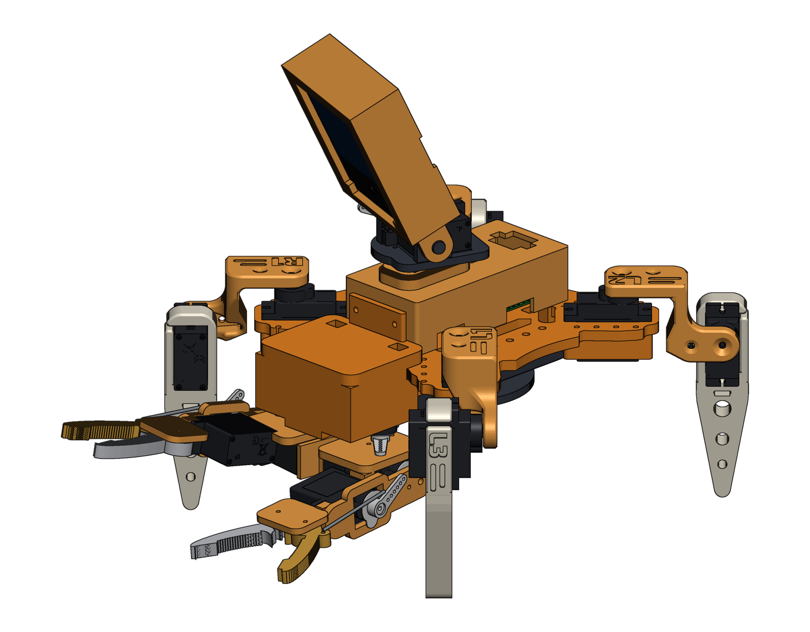
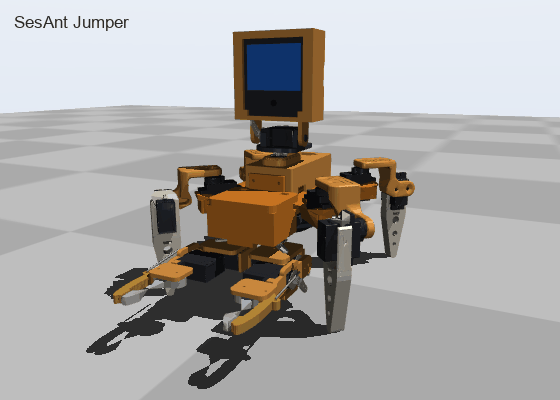
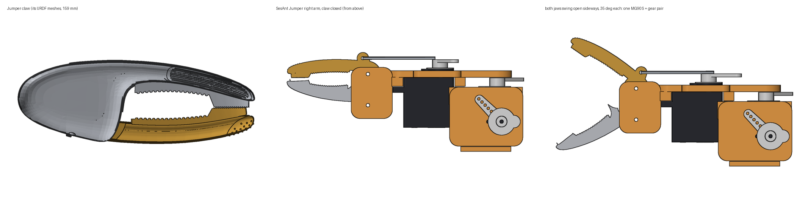
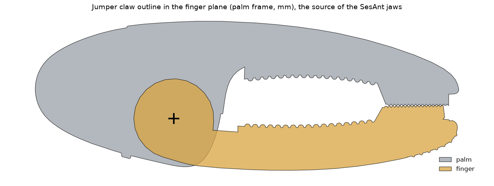
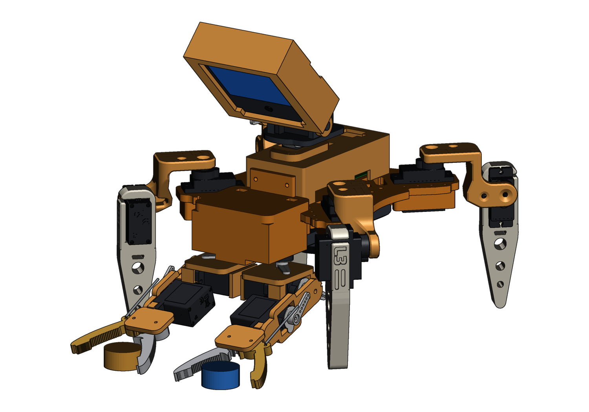
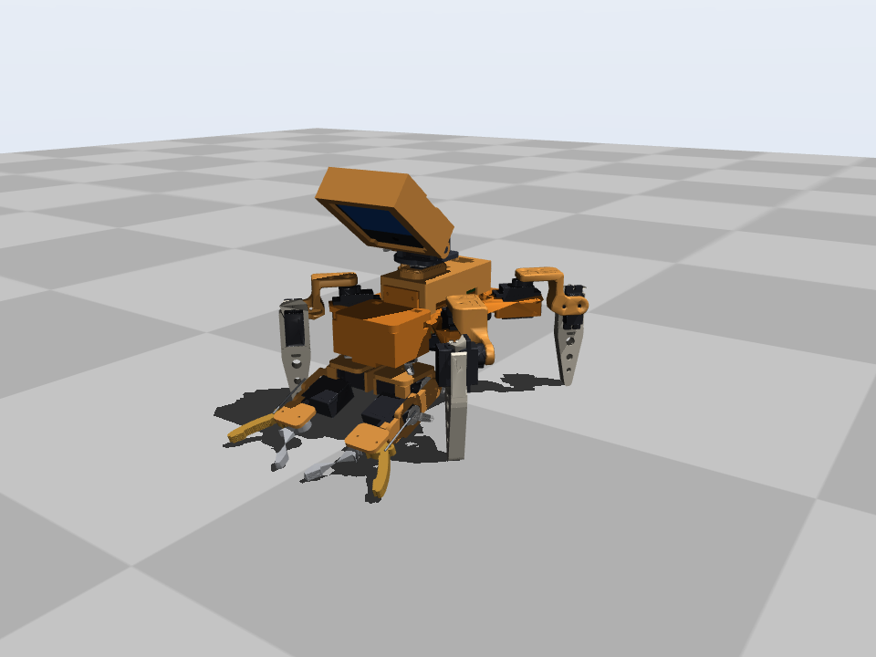

# SesAnt Jumper: the Jumper remix (arms with two-jaw claws + simulator)





*Simulated in MuJoCo from `sim/scene.xml` with scripted servo targets (`cad/scripts/jumper_animate.py`), not a learned policy.*

[Jumper](https://github.com/KingKongRobotics/jumper) is KingKong Robotics' 22-DoF crab robot (Apache-2.0): four walking legs plus two front arms with claws. SesAnt Jumper takes its two best ideas and fits them to SesAnt:

1. **Two Jumper-style front arms with two-jaw claws that grab horizontally.** Each arm has 3 MG90S: shoulder yaw, shoulder pitch and a gripper.
   * The claws are Jumper's palm and finger, with the outline taken straight from Jumper's URDF meshes.
   * Both jaws move: one servo turns the finger, and a printed gear pair turns the palm the other way, so both jaws swing sideways together.
   * There is no servo at the claw. The gripper servo sits on the forearm right behind the shoulder and drives the jaws through a thin wire pushrod.
   * The arms replace v3's ant mandibles.
2. **Jumper's simulator and RL training.** A MuJoCo model of SesAnt generated from the CAD, plus a `sesant.flat` walking task that plugs into Jumper's mjlab / rsl_rl training framework. RealAnt-style RL then gets a modern simulator, without RealAnt's camera-and-marker rig.

SesAnt Jumper = v1 body + v2 belly cone (still docks on the home puck) + v3 neck + the two arms. Generated by:
* `cad/scripts/jumper_arms.py`: arm parts and checks
* `cad/scripts/jumper_sim.py`: MuJoCo model and simulation checks
* `cad/scripts/jumper_render.py`, `jumper_animate.py`: images and the animation
* `cad/scripts/jumper_step.py`: [`SesAnt Jumper.step`](../SesAnt%20Jumper.step) in the repo root, the whole robot as one STEP assembly (standing, arms in the carry pose). It's built from the meshes: printed parts are faceted within 0.1–0.2 mm, servos and electronics are boxes. It's for viewing and for importing, for example to create a Tnkr project from the GitHub repo, not editable parametric CAD.

Nothing has been printed yet.

## 1. Two Jumper arms



**Layout (per arm; the left arm is the mirror image of the right one):**
* **Shoulder yaw:** an MG90S hangs shaft-down in the arm-base housing, which sits on the chassis' front plate tongue and bolts to the cover front wall.
* **Shoulder pitch:** an MG90S lies under the yaw horn on a shoulder bracket, with its shaft pointing outward. The forearm hangs on its horn.
* **Gripper, without a servo at the claw:** an MG90S lies on the inside of the forearm, right behind the shoulder, low under the front legs' knee servos.
  * Its horn drives a 1.2 mm steel-wire pushrod, RC-style with Z-bends, along the outside of the forearm to a lever on the finger jaw. The linkage gives about 1 servo degree per jaw degree.
  * At the claw there is only a slim plate holding the two jaw pivots (M2 screws). The palm-jaw pivot sits 14 mm further inside than the finger's.
  * A gear pair (m 1, 14 teeth) turns the palm jaw the other way, so **both jaws swing open sideways together**, 35° each.
  * The claws grab horizontally: palm on the inside, finger on the outside, closing around an object in front of the robot. The forearm is 58 mm long.
* **Jaw shape:** the Jumper LF palm group (palm, pads, grip insert) and finger group (finger, tip, grip insert), taken in the palm frame, projected onto the finger's plane and scaled ×0.34.
  

| File | Qty | Size (mm) | Notes |
|---|---|---|---|
| `sesant_jumper_arm_housing.stl` | 1 | 40 × 49 × 40 | Holds the two yaw servos lying forward. Sits on the chassis' front plate tongue, with a lip bolted to the cover. Prints upside down. |
| `sesant_jumper_shoulder_left/right.stl` | 1 + 1 | 33 × 29 × 16 | Plate on the yaw horn, cheek and tab posts for the pitch servo. Prints plate-down. |
| `sesant_jumper_forearm_left/right.stl` | 1 + 1 | see `print_orientation.png` | Plate on the pitch horn, with tab posts for the gripper servo on its inside, a slot for the servo's output, and the slim claw plate with both jaw pivots. Prints on its side; tree supports under the claw plate. |
| `sesant_jumper_jaw_palm_left/right.stl` | 1 + 1 | 44 × 19 × 5 | Jumper palm outline with its grip ridges and a gear sector, on an M2 pivot under the post. Prints flat. |
| `sesant_jumper_jaw_finger_left/right.stl` | 1 + 1 | 44 × 15 × 5 | Jumper finger outline with a gear sector and the pushrod lever, on an M2 pivot under the claw plate. Prints flat. |

**Verified in CAD** (`assembly/sesant_jumper_arms_report.txt`):
* **Jaws:** the gears mesh with zero overlap over 0–35°. The jaw bodies never come closer than 0.4 mm, the claw closes to a 0.9 mm gap, and with both jaws open the tips are 48 mm apart.
* **Pushrod linkage:** the servo moves from +18° to −19° for jaws 0–35°, smoothly in one direction. The rod (32.6 mm) clears the forearm, the servo and both jaws over the whole range.
* **Fit:** all 6 servos sit clear in their brackets. The housing sits on the plate tongue without overlapping the chassis or the cover.
* **Range:** every arm pose within the joint limits is collision-free against the body, the head, the standing legs and the other arm.
  * Yaw −5…+15° (+ = outward; one arm alone can go to −15°). Further out, the arm meets the front knee servo.
  * Pitch from 15° up (enough to clear the puck when docking) to 70° down.
* **Front legs:**
  * Arms in the carry pose (level, claws closed): the front hips can swing ±21° toward the front, enough for walking. The gripper horn and pushrod on the outside of each forearm set this limit.
  * Arms swung out with the claws open: ±6°. So walk with the arms level (the firmware's `carry` and the training task), and lift them only to dock.
* **Reach:** standing, both arms tilted 19° down put the open claws 2 mm above the floor, 100 mm in front of the body. Only the feet touch the floor, and the CoM stays 46 mm inside the support polygon.
  * Tilting the head 51° down centres the camera between the claws, which are about 13° either side of its axis.
* **Load:** the shoulder pitch carries 17 g at 35 mm, about 3 % of MG90S stall, since the gripper servo now sits near the shoulder. Grip is about 4.9 N per jaw (est.).
* **Mass:** about 460 g (est.). Across arm poses, the standing CoM stays at least 50 mm inside the support polygon.
* **Docking:** `dock` lifts the arms 15° first. The robot then sits on the v2 home puck with only the belly cone touching. The puck's flag tongue is now 3 mm high so the arms pass over it.



**Firmware:** `firmware/sesant_jumper_body/` is the v3 firmware with the mandible servo replaced by the 6 arm servos. It compiles (28 % flash).

| Joint | Left GPIO | Right GPIO | Range |
|---|---|---|---|
| Shoulder yaw | 9 | 7 | −5…+15° (+ = outward) |
| Shoulder pitch | 12 | 11 | −15…+70° (+ = down) |
| Gripper | 16 | 15 | 0…35° per jaw (servo angle = 18.4 − 1.07 × jaw, through the pushrod) |

GPIO 15 also drives the S2 Mini's on-board LED, which will flicker; that's harmless.

* **Commands:**
  * `arm_l` / `arm_r` / `arms` take `<yaw> <pitch> <jaw>`.
  * `jaw`, `grab` and `release` move both grippers.
  * `carry` levels the arms and closes the claws (walking); `dock` lifts them 15° before sitting down.
  * `reach` puts both claws open at the floor and points the head at them.
* **`meas`:** the 6 arm setpoints are appended after the neck angles.
* **Calibration:** flip a sign in `ARM_DIR` if a joint moves the wrong way.

**BOM change against v3** (arms instead of mandibles):
* +5 MG90S, so 6 arm servos in total
* 2× 1.2 mm steel wire pushrods (~45 mm before the Z-bends)
* M2 screws: horns, tabs, the palm-jaw pivots and the housing lip (+2 nuts)
* Servo leads to GPIO 7, 9, 11, 12, 15 and 16

## 2. Simulator: MuJoCo model + Jumper training task



`sesant_jumper/sim/` holds:

| Path | What |
|---|---|
| `sesant.xml` | **Robot only, in mjlab's entity format:** free base and IMU sensors (gyro, velocimeter, accelerometer, up-vector, angular momentum), the same names as mjlab's Go1.<br>Also: foot sites `FL FR BR BL`, collision geoms `*_collision`, and a `cores3` camera in the head.<br>18 joints: `<leg>_hip`, `<leg>_knee`, `neck_pan`, `neck_tilt`, and `arm_<l|r>_yaw`, `_pitch`, `_jaw`, `_jaw2`, with the CAD ranges. `_jaw2` (the palm jaw) is tied to `_jaw` by an equality constraint, which stands in for the gear pair. |
| `scene.xml` | `sesant.xml` plus a floor, 16 position actuators and `stand` / `carry` / `reach` keyframes, for plain MuJoCo (`python -m mujoco.viewer --mjcf scene.xml`). |
| `meshes/` | One visual mesh per part (decimated to ≤2500 faces) and one convex collision hull per body. |
| `jumper_tasks/sesant/` | The `sesant.flat` task for Jumper's task registry (`common/` robot config, `flat/` env and PPO config), the same layout as `tasks/jumper/`. |
| `install_into_jumper.sh` | Copies the model to `<jumper>/assets/sesant/` and the task to `<jumper>/tasks/sesant/`, and adds the one import line the registry needs. |

**Model:**
* Every link carries its CAD meshes at its CAD joint axis.
* Masses come from the same estimate the CAD checks use (460 g in total); inertias come from each body's convex hull.
* Servos are modelled as position actuators, saturating at stall: MG90S 0.21 N·m, SCS0009 0.22 N·m (est.), with armature for a ~1:300 gearbox.
* Collision is robot-vs-ground only. The hulls overlap at the joints by construction.

**Checked in MuJoCo 3.11** (`assembly/sesant_jumper_sim_report.txt`; numbers are for simulation only):
* **Standing:** the base settles 0.4 mm below the CAD height. Only the 4 feet touch the floor, and the actuators run at 4 % of stall.
* **Reach:** standing with both arms 19° down and the claws open, the lowest jaw ends 0.6 mm above the floor (CAD 2.0) and only the feet touch. The palm jaw follows the finger jaw through the coupling (within 0.01°), and the servos peak at 12 % of stall. The pushrod linkage is drawn but not simulated; the jaw joint stands in for it.
* **Neck and arms:** sweeping the neck ±120° while both arms run through yaw, pitch (down to floor height) and jaws in antiphase tilts the body by at most 0.2°.
* **Drop:** dropped from 30 mm, it lands upright.

**Training** (Jumper's framework, CPU backend):
```bash
./install_into_jumper.sh /path/to/jumper
cd /path/to/jumper && pip install -e .
python scripts/train.py --task sesant.flat --model sesant                                   # GPU (warp)
python scripts/train.py --task sesant.flat --model sesant --backend native --device cpu --num_envs 64
```
`sesant.flat` is mjlab's velocity-tracking skeleton (as in its Go1 flat task), scaled to SesAnt:
* **Actions:** only the 8 leg joints. The neck and arms are held under their PD, with the arms in the carry pose (level, claws closed).
* **Actor observations:** no base linear velocity (there is no sensor for it) and no joint velocity (MG90S has no feedback). `joint_pos` stands for the firmware's open-loop position estimate.
* **Scale:** speeds up to 0.25 m/s and 0.8 rad/s, 15 mm swing height, pushes sized for a 0.46 kg robot.
* **IMU:** in simulation the IMU sits on the base. On the robot it is the CoreS3's, in the moving head: rotate it by the measured neck angles from `meas` first.

**Smoke test (done here, in a scratch copy of Jumper; your checkout is untouched):**
* `install_into_jumper.sh` and `train.py --list` show the task.
* 400 PPO iterations ran on the arm model with 64 environments on the CPU backend (2 min 55 s on a laptop):
  * Mean reward climbed from 1.6 (first logged iteration) to 80.
  * Episodes went from 37 steps to the full 1000 (20 s), with no falls after iteration 90.
  * The action noise dropped from 1.0 to 0.26.

That only shows the task is wired up and learnable. It is not a trained gait: expect thousands of iterations on a GPU (`--num_envs 4096`) before a policy is worth playing back or putting on the robot.

## Credits
Jumper © 2026 KingKong Robotics, Apache-2.0. Only the claw outline (projected from its URDF meshes), the arm layout idea and the structure of its training framework are used. mjlab and rsl_rl are vendored in Jumper under their own licences.
