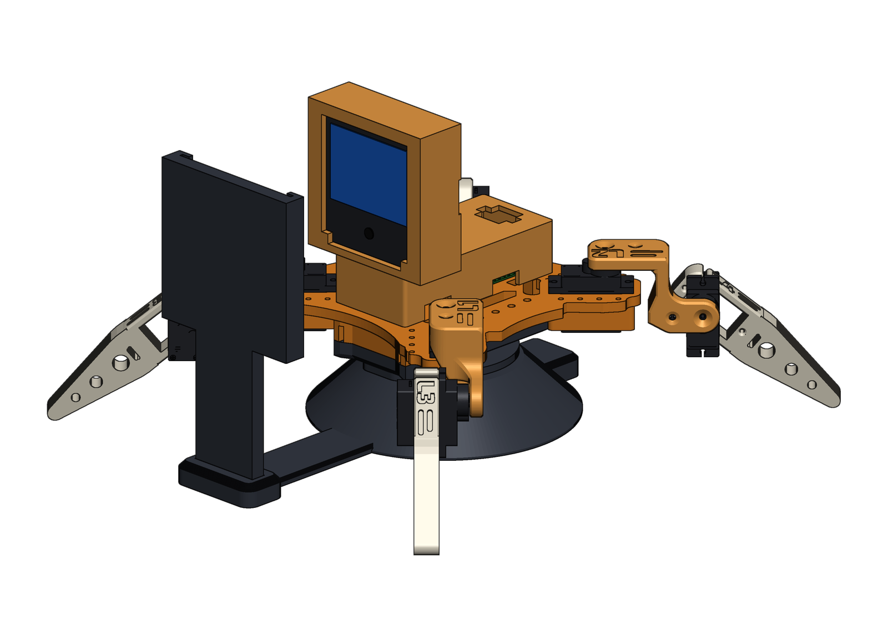
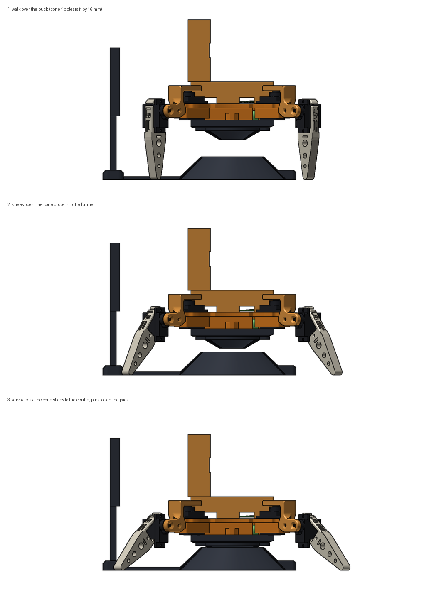
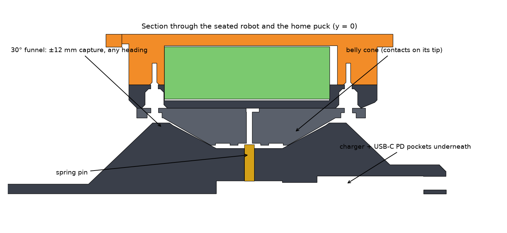
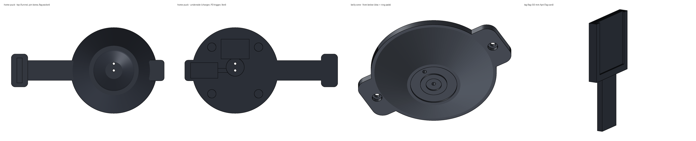

# SesAnt v2: home puck

v2 lets SesAnt charge itself, and gives RL sessions a repeatable reset pose. Instead of a large dock with one groove per foot, it uses one small round **puck** (104 mm across, 22 mm high) and a **cone under the robot's belly**:

1. The robot walks over the puck. The puck sits between its legs, and the cone clears the puck top by 16 mm.
2. It opens its knees (51° outward), and the belly cone drops into the puck's 30° funnel.
3. Its servos relax. The cone slides down the funnel walls to the centre, and two spring pins meet the contact pads on the cone tip.

The cone and funnel do the aligning, not the feet. The robot can arrive **up to ±12 mm off centre**, and the contacts work at **any heading**. They are a centre disc and a ring, so they don't care how the robot is turned. Seated on the puck, the robot is in a known pose, which doubles as the **RL episode reset pose**.

Everything is generated from the v1 assembly by `cad/scripts/v2_puck.py` and checked in the same script. Nothing has been printed yet.

## Parts (`stl/`, oriented for printing, all watertight)

| File | Qty | Size (mm) | Notes |
|---|---|---|---|
| `sesant_v2_home_puck.stl` | 1 | 185 × 104 × 22 | Round puck with a 30° funnel, 2 pogo-pin bores and a solder cavity. Underneath it has pockets for the charger and USB-C PD trigger, plus rubber-foot recesses. A front tongue carries the flag; a rear tab holds the USB-C socket. Prints flat with no supports. |
| `sesant_v2_belly_cone.stl` | 1 | 71 × 56 × 12 | Bolts under the bottom cover with the cover's own 2 screws (use M2 screws 3 mm longer). Its 24 mm tip carries the disc (+) and ring (GND) pads. Prints flange-down with no supports. |
| `sesant_v2_bottom_cover.stl` | 1 | 79 × 38 × 7 | v1 bottom cover plus 2 wire holes behind the battery. |
| `sesant_v2_tag_flag.stl` | 1 | 124 × 66 × 9 | Plugs into the tongue and holds a 58 mm card with a 50 mm AprilTag (tag36h11 id 0). Prints lying on its back. |

## Verification (`assembly/v2_verification_report.txt`)
* **Seat pose:** knees **50.6° outward**, which is **RealAnt knee value 396** (stand = 224). The body drops 23 mm, and the feet slide out to r 146 mm on the floor.
* **Seated:** pushing the robot 0.3 mm further down touches **only the belly cone**.
  * The flange stays 1.6 mm above the puck top.
  * The cone tip floats 1 mm above the funnel floor, where the pins reach it.
* **Capture:** the robot is lowered from cone-tip height down to the seat many times.
  * Offsets are 0–11 mm in 8 directions, at headings of 0 and ±15°, plus ±30° when centred.
  * In every run, the belly cone is the first part to touch the puck.
  * The 30° walls (tan 30° = 0.58) are steeper than PLA-on-PLA friction (~0.3), so the cone slides once the servos let go.
* **Heading:** the contacts work at any heading.
  * With the flag fitted, the robot must face it to within ±30° when centred, or ±15° at the full ±11 mm offset. Otherwise a foot lands on the flag tongue. It homes on that tag anyway.
* **Contacts:** with 1 mm of residual error, the centre pin stays inside the 3.5 mm disc and the outer pin (r 8.25) stays on the ring (6–10.5). This holds at any heading, and polarity can't reverse.
* **Camera:** the tag is 70 mm from the CoreS3 camera. Its centre is at z 94, between the seated (83) and standing (106) camera heights, and the tag spans ±20° of the field of view.
* **Knee load** at the end of the lowering: about 0.4 kg·cm per knee, against roughly 2.2 kg·cm MG90S stall.

Not verified:
* real friction in the funnel, and whether limp MG90S legs let the body slide
* contact resistance at 1 A
* charger temperature inside the puck

## Electronics
* **Puck:**
  * A USB-C PD trigger board (12 V) in the rear tab feeds a TP5100-class 2S CC/CV charger (8.4 V, ≤1 A) under the puck.
  * Two 3 mm spring pins, about 12 mm long: centre = +, outer = GND.
* **Robot:** the pads go through an SS34 Schottky diode and a 1.5 A polyfuse into the 2S pack's BMS.
  * Two 100k/27k dividers feed the S2 Mini ADC: battery voltage on GPIO 3, pad voltage on GPIO 5.

## Firmware: `firmware/sesant_v2_puck/`
This is v1's RealAnt bridge plus:
* **`dock`:** the robot must be standing over the puck. It ramps its knees to the seat pose over 2 s (2° past the CAD value), holds for 0.4 s, then turns the servos off.
  * It then reports `charging`, or `no contact` if the pads see no charger voltage.
* **`undock`:** servos on at the seat pose, then a ramp back to standup.
* **`battery`:** prints the battery voltage, pad voltage and dock state.
* **`meas`:** the 29 RealAnt fields and free heap, then `vbat_mV charge_mV dock_state`. `ant_server.py` reads the first 29 fields unchanged.

It compiles for `esp32:esp32:lolin_s2_mini` (28 % flash).

`tools/dock_bench.py /dev/ttyACM0 --cycles 100` runs undock → stand → dock cycles and logs the results to CSV (`--selftest` checks the parser).

## BOM additions over v1
* 2× 3 mm spring pogo pins (≥2 A, ~1.5 mm travel, ~12 mm long)
* 0.5 mm brass sheet or copper tape for the disc and ring
* USB-C PD trigger board (12 V), TP5100 2S charger module
* SS34 Schottky diode, 1.5 A polyfuse, 2× 100k + 2× 27k resistors
* 2× M2 screws, 3 mm longer than the bottom-cover screws
* 4× Ø10 rubber feet

## Assembly
1. **Puck:** press the pins into the bores so they stand 2 mm above the funnel floor. Solder them from below: centre = charger +, outer = GND. Fit the charger and PD board and route the wires in the underside channels.
2. **Robot:**
   * Glue the brass disc and ring into the cone tip, and run the wires up through the cone. They follow the grooves in the flange and go into the body through the two new cover holes.
   * Fit the cone and the new cover with the two longer screws.
   * Add the diode, fuse and dividers.
3. **Test:** flash `sesant_v2_puck`, calibrate `TRIM`/`DIR` as in v1, and stand the robot over the puck. Send `dock`, then check that `charge_mV` rises and the state goes to 3.
