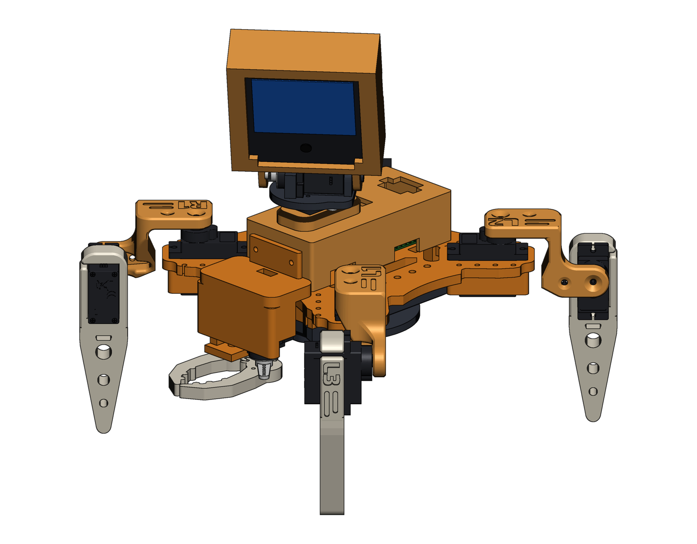
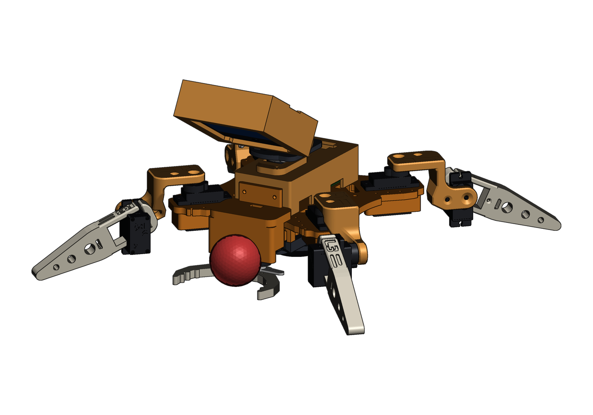
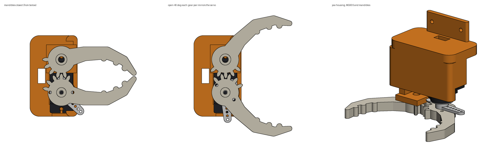
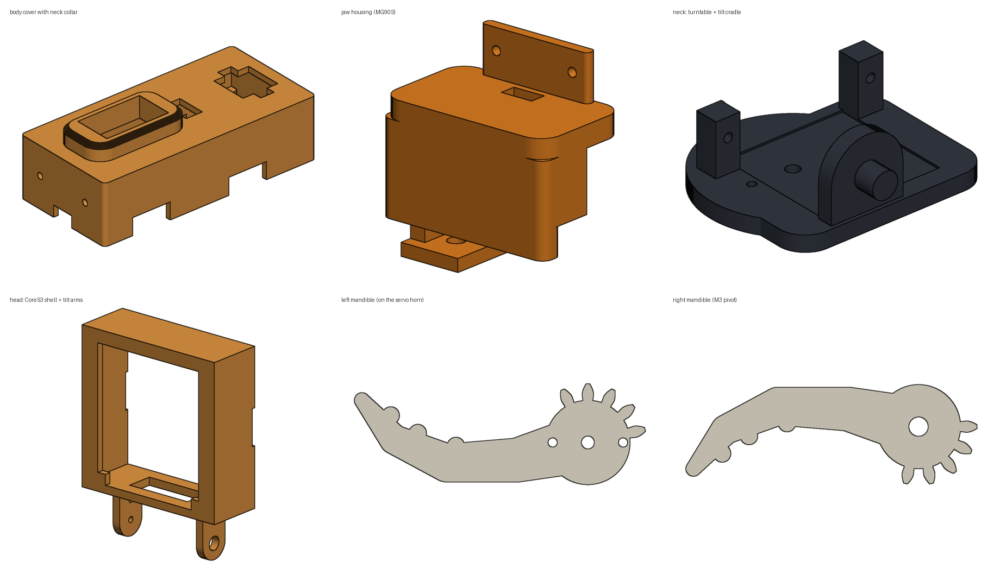

# SesAnt v3: StackChan neck + ant mandibles

v3 stays at v1 size and on v1's MG90S electronics, and adds two things:

* **A neck.** The CoreS3 head moves off the body cover onto a pan/tilt neck made of two **Feetech SCS0009** serial servos. These are the servos StackChan's own body uses, with the same IDs, protocol and step size (see `StackChan/firmware/main/hal/hal_servo.cpp`). The camera can look around while the body walks, and look down at what the robot is doing.
* **Ant mandibles.** One MG90S under the front of the body turns the left mandible, and a printed involute gear pair mirrors it onto the right one. The robot crouches, opens its mandibles at floor level, and picks up small objects such as a bottle cap, a 30 mm ball or a cable. The head watches from above.

So all three source robots now do real work: RealAnt's body plan and blade legs, Sesame's servos and electronics, and StackChan's head *and* neck. v3 keeps v2's belly cone, so it still charges on the home puck.

Everything is generated by `cad/scripts/v3_neck_jaw.py` on top of the v1 and v2 builds, and checked in the same script. Nothing has been printed yet.

## Parts (`stl/`, oriented for printing, all watertight)

| File | Qty | Size (mm) | Notes |
|---|---|---|---|
| `sesant_v3_body_cover.stl` | 1 | 79 × 37 × 27 | Replaces v1's `sesant_stackchan_head`: the same body cover without the face, plus a collar for the pan servo, which hangs inside the cover. Prints rim-down, like v1. |
| `sesant_v3_neck.stl` | 1 | 40 × 38 × 16 | Turntable on the pan horn, cradle for the tilt servo, and a cheek with a Ø4.9 pivot pin. |
| `sesant_v3_head.stl` | 1 | 22 × 60 × 78 | The v1 CoreS3 pocket (open back, crush ribs) with two arms down to the tilt axis: one screws to the tilt horn, the other rides the pin. Prints upside down; the floor is a bridge. |
| `sesant_v3_jaw_housing.stl` | 1 | 25 × 43 × 45 | Holds the jaw MG90S shaft-down in front of the chassis plate tongue. A shelf carries the right mandible's M3 pivot, and a lip bolts to the cover front. Prints upside down; use tree supports under the shelf. |
| `sesant_v3_mandible_left.stl` | 1 | 50 × 17 × 5 | On the jaw servo horn (2× M2). Gear sector m 1.25, z 14. |
| `sesant_v3_mandible_right.stl` | 1 | 50 × 17 × 5 | On an M3 screw into a heat-set insert in the shelf. Its gear is half a tooth out of phase with the left one. |

v2's `sesant_v2_belly_cone` and `sesant_v2_bottom_cover` are reused unchanged.

## Verification (`assembly/v3_verification_report.txt`)
* **Size and mass:** 185 mm tall standing (v1: 153). Footprint 181 × 167 mm. Estimated mass 372 g; CoM 86 mm above the floor.
* **Fit:** pan servo, jaw servo and S2 Mini are clear of the cover, housing and chassis. The jaw housing rests on the chassis plate tongue and doesn't overlap the cover.
* **Neck:** pan all the way round in 15° steps, against every tilt angle.
  * Head, CoreS3, neck and tilt servo are collision-free from **25° up to 70° down**.
  * The firmware allows tilt −20…+60 and pan ±120 (a cable-loop limit, not a mechanical one).
  * Standing stability across the neck range: the CoM stays at least 56 mm inside the support polygon.
* **Gears:** zero overlap between the two gear sectors over the 0–40° opening, with 0.14 mm closest approach. They mesh without binding.
* **Mandibles:**
  * The gap is 0.5 mm when closed; when open, the tips are 56 mm apart.
  * The tips reach 52 mm in front of the body (x = −92).
  * They are collision-free against the housing, servo, chassis and belly cone.
* **Grip:** about 2.8 N per tip, enough for objects up to about 230 g at μ 0.4 (est.).
* **Front hips with the jaw fitted:** −42…+90° (FL) and −90…+42° (FR). Only the forward swing toward the snout is limited (v1: ±90°). The rear hips are unchanged.
* **Grab pose (`crouch`):**
  * The body stays level, with knees 65° outward (RealAnt 446 / 447).
  * The open mandibles end up 2 mm above the floor, and the next-lowest part, the belly cone, is 1.5 mm above it.
  * Only the 4 feet touch the floor, and the CoM is 97 mm inside the support polygon.
  * **Tilting the head 60° down** puts the mandible tips on the camera axis, 91 mm away.
* **Paw pose (`paw`):**
  * Support hips are FR +40° and BL −45°, which keeps the CoM 14 mm inside the FR–BR–BL triangle.
  * FL swings −20° and its knee lifts 95°, putting the foot tip at 56 mm height.
  * The lifted leg is clear of the body.
* **Docking:** the robot still sits on the v2 home puck with only the belly cone touching. Tilting the head 28° (standing) or 13° (seated) centres the AprilTag in the camera.

Not verified:
* real SCS0009 dimensions (modelled as the SG90 body from the Sesame STEP)
* gear backlash after printing
* grip on real objects
* how well the crouch works on slippery floors
* bus timing on hardware

## Firmware: `firmware/sesant_v3_body/`
This is the v2 puck firmware plus:
* **Neck:**
  * The SCS bus runs on Serial1: TX GPIO 17 → 1 kΩ → data line, RX GPIO 18 straight to the data line, at 1 Mbps. The firmware skips its own echo.
  * Servo IDs are 1 = pan and 2 = tilt; the StackChan mapping is 0.3125°/step.
  * `neck <pan> <tilt>` moves the head, `neck_zero` stores the current position as straight ahead (in NVS), and `neck_torque 0|1` turns the neck on or off.
  * The measured pan and tilt angles go into `meas`.
* **Jaw:** an MG90S on GPIO 7. `jaw <0..40>` sets the opening; `grab` and `release` close and open it. (SesAnt Jumper replaces the mandibles with two arms and has its own firmware, `sesant_jumper/firmware/sesant_jumper_body`.)
* **Macros:**
  * `crouch`: the grab pose above, with mandibles open and head looking down.
  * `paw`: shift onto three feet, lift FL, tap twice, then stand up again. If the support legs swing the wrong way during calibration, flip `HIP_SIGN`.
* **CoreS3 link:** the same command lines are accepted on Serial0 (RX 37 / TX 39), so the head can drive the body and neck from its camera.
* **`meas`:** the 29 RealAnt fields, heap, `vbat charge state` (v2), then `pan_deg tilt_deg jaw_deg`.

It compiles for `esp32:esp32:lolin_s2_mini` (28 % flash).

## BOM additions over v2
* 2× Feetech SCS0009 serial servos (the StackChan neck servos) and one 3-pin bus lead; a 1 kΩ resistor
* 1× MG90S (jaw)
* 1× M3×10 screw + M3 heat-set insert (right mandible pivot); M2 screws for the horns, tabs and housing lip (+2 nuts)
* A longer, flexible 4-wire lead for the CoreS3 (5 V, GND, UART), with a service loop behind the neck

## Assembly
1. **Pan servo:** screw it into the body cover from below (tabs against the roof, 2× M2 into the collar), shaft up, cable toward the back. Fit the cover as in v1.
2. **Neck:** screw the neck turntable to the pan horn. Set the pan servo to its centre first, so the cradle faces forward.
3. **Tilt servo:** lay it in the cradle, shaft to the right (+Y), and screw the tabs to the posts.
4. **Head:** slide the head's left arm over the pin, and screw the right arm to the tilt horn with the head upright. Slide in the CoreS3 and run its cable down behind the neck into the roof hole.
5. **Jaw:** screw the jaw MG90S into the housing, shaft down. Screw the left mandible to its horn with the jaw closed, then fit the right mandible on its M3 pivot so the gears mesh with both tips touching.
6. **Fit the jaw:** set the housing on the chassis' front plate tongue, and bolt its lip to the cover front wall (2× M2 + nuts).
7. **First power-up:** flash `sesant_v3_body`, run `neck_torque 0`, set the head straight and level by hand, then run `neck_zero`. Check `jaw 40` and `grab`, then `crouch`.
